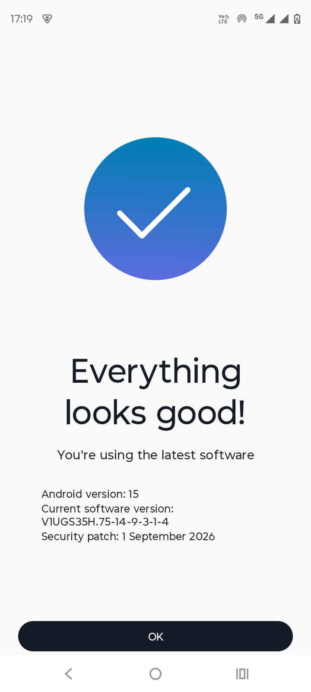

# Moto G45 5G bootloop — diagnosis lengkap, perbaikan, dan panduan pemulihan

**Bahasa Indonesia** · [English](README.md)

**Perangkat:** Motorola Moto G45 5G · `XT2363-9` · codename **`fogos`** · Snapdragon 6s Gen 3 (`SM6375`)
**Gejala:** HP restart sendiri setiap **~2 menit**, terus-menerus, dan tetap terjadi setelah tiga kali flash firmware berbeda
**Akar masalah:** **use-after-free di library oemhook proprietary Motorola**, dipicu oleh **state modem/telephony lama di `/data`**
**Yang benar-benar memperbaiki:** **factory reset** — bukan OTA, bukan firmware full terbaru, bukan build security patch terbaru, bukan menonaktifkan package
**Status:** stabil setelah dua kali factory reset berturut-turut, nol crash, 5G + VoLTE jalan (diverifikasi lewat beberapa kali reboot)

Repo ini adalah tulisan yang sudah disanitasi dan bisa direproduksi dari satu perangkat: apa yang rusak, kenapa, apa yang kami coba, apa yang berhasil, apa yang **tidak**, dan cara melindungi data sebelum wipe.

> **Tidak berafiliasi dengan Motorola, Qualcomm, atau Google.** Semua isi di sini berasal dari satu perangkat ditambah pengetahuan umum Android/Qualcomm. Baca [Penafian](#penafian) sebelum menjalankan apa pun.

> **Ditulis bersama AI.** Diagnosis, skrip, dan dokumentasi repo ini dibuat oleh pemilik repo bersama **agen AI** (DeepSeek V4.1 Flash via OpenCode). Bukti perangkatnya asli; teks dan analisisnya disusun dengan bantuan AI lalu diperiksa terhadap log yang direkam. Artinya: anggap ini **titik awal yang kuat, bukan otoritas**. Setiap klaim teknis bisa dicek di [`evidence/`](evidence/). Detail lengkap: [`docs/11-ai-assisted-debugging.md`](docs/11-ai-assisted-debugging.md).

---

## Sebelum mulai — yang kamu butuhkan

Ini bukan perbaikan yang cukup dilakukan di HP saja. Kamu butuh **PC** dan **kabel**, dan sebagian besar kegagalan terjadi sebelum perintah pertama.

| Yang wajib ada | Kenapa |
|---|---|
| **PC/laptop Windows 10/11** (hak admin) | LMSA/Software Fix Motorola hanya untuk Windows; semua skrip di sini PowerShell |
| **Kabel USB *data*** — bukan kabel charge-only | Kabel charge-only tidak bisa membawa ADB. Ini penyebab #1 "`adb devices` kosong" |
| **ADB terpasang** (Android SDK Platform-Tools) | Semua diagnosis dan perbaikan memakai ini |
| **USB debugging + "Always allow" + screen lock dimatikan** | Jendela boot hanya 1,5–3 menit; buka kunci HP makan waktu. Set lock ke **None** sementara |
| **Port USB langsung** (tanpa hub/dock) | Hub memutus koneksi di tengah flash |
| **Internet di PC** + **disk kosong 30–60 GB** | Platform-Tools, gnirehtet, firmware 2–5 GB, backup |
| **HP terisi > 50 %** | Boot pertama setelah reset bisa 15 menit |
| **Password akun Google** | Factory Reset Protection tetap berlaku walau tanpa screen lock |
| **PIN screen lock diketahui** | Kamu butuh untuk mematikan lock, dan memasangnya lagi nanti |
| **Seed 2FA sudah diekspor, backup sudah selesai** | Wipe menghapusnya permanen |

**Checklist lengkap, driver, troubleshooting kabel, dan daftar "apa saya sudah siap?":** [`docs/00-requirements.md`](docs/00-requirements.md)

> Kamu **tidak** butuh root, bootloader unlocked, custom ROM, atau tool berbayar.

---

## Ringkasan cepat — kalau HP kamu sedang bootloop sekarang

| # | Lakukan ini | Kenapa |
|---|---|---|
| 1 | **Backup dulu** → [`docs/06-backup.md`](docs/06-backup.md) | Factory reset menghancurkan `/data`, termasuk kunci dekripsi WhatsApp dan seed authenticator 2FA |
| 2 | Pastikan ini *bug yang sama* → [`docs/01-symptoms.md`](docs/01-symptoms.md) | Reboot loop ~2 menit dengan `qcrilNrd` di crash buffer adalah sidik jarinya |
| 3 | Dapatkan internet tanpa Wi-Fi/SIM → [`docs/07-internet-without-wifi-or-sim.md`](docs/07-internet-without-wifi-or-sim.md) | `gnirehtet` melakukan reverse tether lewat USB — tanpa root, tanpa Wi-Fi, tanpa SIM |
| 4 | **Factory reset** (Recovery → Wipe data/factory reset) | Inilah yang menghentikan loop. ~5 menit |
| 5 | Masih loop? → flash full via LMSA **dengan opsi "factory reset" dicentang** | Mengganti image vendor/modem *dan* menghapus userdata |
| 6 | Verifikasi dengan [`scripts/adb/verify-stability`](scripts/adb/) | Stabil = 0 crash `qcrilNrd` setelah uptime 10+ menit |

Kalau kamu punya 30 detik, baca [penjelasan satu layar](docs/03-root-cause.md#the-short-version).

---

## Kondisi akhir (terverifikasi)



Setelah reset: **Android 15**, build `V1UGS35H.75-14-9-3-1-4`, security patch **1 September 2026**, 5G + VoLTE terdaftar, nol crash `qcrilNrd`.

HP ini melewati **tiga kali flash firmware** sebelum reset — update Android 15, firmware full terbaru lewat Motorola/Lenovo Software Fix, dan build security patch terbaru — dan tetap loop di semuanya. Hanya menghapus userdata yang memperbaikinya.

---

## Sebenarnya apa yang terjadi

HP punya dua komputer: **AP** (Android, aplikasi kamu) dan **modem/baseband** (radio, SIM, telepon, data). Keduanya bicara lewat kanal bernama **oemhook**, dijembatani oleh daemon RIL Qualcomm `qcrilNrd`.

Di perangkat ini, Motorola menyertakan library vendor `libmotext_inf.so` yang menangani lalu lintas oemhook. Library itu mengandung bug:

```
Process:  /vendor/bin/hw/qcrilNrd  (uid 1001)
Signal:   SIGSEGV, SEGV_MAPERR, fault addr 0xffffffffffffff02
#00  libqcrilNr.so    qcril_qmi_oem_free_and_convert_ril_token_to_oem_token
#01  libqcrilNr.so    qcril_qmi_oemhook_agent_send
#02  libqcrilNr.so    mot_qcril_qmi_oemhook_agent_send
#03  libmotext_inf.so communicationThread      <-- proprietary Motorola
#04  libc.so          __pthread_start
```

Sebuah RIL token yang sudah di-*free* (`0xffffffffffffff02` = `-254`, pointer "beracun" klasik) di-dereference. `qcrilNrd` mati. `system_server` menunggu Binder call yang tidak akan pernah kembali. Setelah ~60 detik **watchdog** mematikan sistem dan HP reboot. Ulang setiap 2 menit.

Bug ini *dormant* di HP sehat. Dia hanya menyala saat modem mengirim indikasi oemhook tak diminta (`RegRAT`, `UpdateOperator`, `DataState`, `APMState`, `VoiceCallCount`) dalam state yang tidak diharapkan library. Di kasus ini state itu berasal dari **data telephony lama yang terbawa dari sebelum crash loop dimulai**.

Karena itu:

- **OTA Android 15 tidak membantu** — partisi vendor dan firmware modem tidak berubah.
- **Flash LMSA "no factory delete" tidak membantu** — tool itu sengaja mempertahankan `/data`, dan pemicunya ada di `/data`.
- **Menonaktifkan 13 package hanya menurunkan frekuensi crash** — aplikasi adalah *pengirim* lalu lintas oemhook, bukan *penyebabnya*.
- **Factory reset memperbaikinya** — dia menghapus `/data/vendor/radio`, state carrier/APN, dan reprovision stack modem saat boot pertama.

Analisis lengkap, termasuk kenapa penjelasan populer "factory reset membersihkan NVRAM modem" tidak tepat: **[`docs/03-root-cause.md`](docs/03-root-cause.md)**.

---

## Peta repositori

```
README.md                     versi English
README.id.md                  kamu di sini (Bahasa Indonesia)
docs/
  00-requirements.md          PC, kabel, ADB, driver, akun, checklist pra-terbang
  01-symptoms.md              bedakan bootloop ini vs. penyebab lain
  02-diagnosis.md             kumpulkan bukti dengan ADB; baca tombstone
  03-root-cause.md            bug-nya, pemicunya, kenapa tiap perbaikan berperilaku begitu
  04-fixes.md                 perbaikan berurut + langkah pasti + apa yang dihancurkan
  05-tutorial.md              panduan bahasa sederhana, dari awal sampai akhir
  06-backup.md                apa yang harus dibackup, apa yang tidak bisa diselamatkan, caranya
  07-internet-without-wifi-or-sim.md   reverse tethering USB dengan gnirehtet
  08-hardening.md             OPSIONAL debloat + monitoring stabilitas
  09-faq.md                   "bisa kambuh?", garansi, root, LineageOS...
  10-evidence-index.md        isi evidence/ dan cara sanitasinya
  11-ai-assisted-debugging.md cara debug pakai AI + ADB, dan kesalahan yang kami lakukan
scripts/
  adb/                        .ps1 + .sh portabel: collect, disable, re-enable, verify
  windows/                    tether keeper + watchdog (path bisa diatur)
evidence/                     crash signature, snapshot, log yang sudah disanitasi
PRIVACY.md                    persis apa yang dihapus sebelum dipublikasikan
LICENSE                       MIT (kode) / CC BY 4.0 (tulisan)
```

---

## Versi singkat perbaikannya

```text
Recovery (Power + Volume Down → "Recovery mode")
  → Wipe data/factory reset
  → Reboot system now
```

Semua isi repo ini ada karena kalimat itu tidak berguna kalau kamu belum backup, tidak bisa memastikan loop-mu bug yang sama, atau reset-nya tidak berhasil.

---

## Debug dengan AI + ADB (disarankan)

Repo ini sendiri didiagnosis dengan bantuan AI. Kamu juga bisa. Kuncinya: **AI tidak bisa melihat HP-mu**, jadi kamu yang harus memberi bukti, dan kamu yang harus memverifikasi.

### Yang AI bagus untuk ini

- Membaca crash buffer native (`SIGSEGV`, pointer beracun, backtrace)
- Menghubungkan gejala yang tampak tidak berhubungan (SIM → data → Wi-Fi → reboot = satu dependensi bersama)
- Menulis skrip sekali-jalan, karena jendela boot cuma ~2 menit
- Menerjemahkan istilah vendor: `qcrilNrd`, `oemhook`, `RegRAT`, `APMState`, `modemst1/2`
- Membantu menyanitasi log sebelum kamu tempel di publik

### Yang AI tidak bisa

- Melihat HP-mu, menjalankan `adb`, atau flash firmware
- Menjamin nama package/prop itu benar — sering halusinasi, jadi cek dengan `pm list packages` / `getprop`
- Memastikan perbaikan berhasil — hanya uptime 10+ menit tanpa crash `qcrilNrd` yang bisa

### Alur yang kami pakai

Ini alur di balik [`evidence/timeline.txt`](evidence/timeline.txt):

```
1. AMATI      Apa yang terjadi, urutannya, berapa lama antar reboot?
2. REKAM      Ambil bukti selagi HP hidup (atau dari storage yang persisten).
3. HIPOTESIS  Satu kalimat: "X menyebabkan Y karena Z."
4. PREDIKSI   "Kalau X penyebabnya, melakukan A harus mengubah B."
5. UJI        Satu perubahan per percobaan. Catat hasilnya.
6. KOREKSI    Kalau prediksi gagal, buang hipotesisnya. Jangan ditambal.
```

Langkah 6 yang paling penting. Hipotesis pertama kami (NVRAM modem) salah, dan perbaikan baru berhasil setelah hipotesis itu dibuang.

### Yang perlu direkam dulu

```bash
adb devices
adb shell getprop > props.txt
adb shell 'cat /proc/uptime'
adb shell getprop ro.boot.bootreason
adb shell 'logcat -d -b crash' > crash.txt
adb shell 'logcat -d -b system' > system.txt
adb shell 'dumpsys telephony.registry' > telephony.txt
adb shell 'dumpsys connectivity' > connectivity.txt
adb shell 'ls -l /data/tombstones' > tombstones.txt
```

Atau pakai skrip yang sudah disediakan:

- [`scripts/adb/collect-evidence.ps1`](scripts/adb/collect-evidence.ps1) (Windows)
- [`scripts/adb/collect-evidence.sh`](scripts/adb/collect-evidence.sh) (Linux/macOS)

> **Tombstone bertahan setelah reboot.** Kalau loop terlalu cepat untuk `logcat` langsung, ambil `/data/tombstones` — isinya tetap ada sampai factory reset berikutnya. Ini trik paling berguna di seluruh panduan ini.

### Template prompt (Bahasa Indonesia)

```text
Kamu membantu saya debug HP Android lewat ADB. Jangan menebak.

Perangkat: Motorola Moto G45 5G (XT2363-9, codename fogos, SM6375)
Build: <ro.build.fingerprint>
Baseband: <gsm.version.baseband>
Gejala: <satu kalimat, sertakan waktunya>
Uptime sebelum reboot: <detik>

Lampiran:
- crash.txt   (logcat -b crash)
- props.txt   (getprop)
- telephony.txt
- connectivity.txt

Aturan:
1. Mulai dari perintah read-only. Jangan erase, flash, atau uninstall.
2. Setiap klaim harus dikutip dari baris yang mendukung di file.
3. Kalau bukti kurang, bilang apa yang harus saya ambil lagi.
4. Beri satu hipotesis per langkah, lengkap dengan prediksi yang bisa diuji.
5. Bilang apa yang akan membuktikan kamu salah.
```

Aturan terakhir itu penting. AI yang tidak bisa salah tidak berguna untuk debugging.

### Sanitasi sebelum ditempel

Log penuh identifier. **Jangan pernah tempel output mentah ke issue publik atau chat.** Minimal hapus:

- `ro.serialno`, `ro.boot.serialno`, `ro.vendor.boot.serialno`
- IMEI / MEID / ICCID / IMSI / nomor telepon
- SSID Wi-Fi, BSSID, alamat MAC
- Nama akun Google dan nilai `authuser=`
- Nama perangkat Bluetooth
- Path lokal (`C:\Users\…`)

Checklist lengkap: [`PRIVACY.md`](PRIVACY.md).

### Kesalahan yang kami lakukan (jangan diulang)

1. **Flash firmware dan berharap `/data` ikut bersih.** Tiga flash gagal karena flash tidak menghapus userdata. Kalau bug-nya di `/data`, flash tidak akan menyelesaikannya.
2. **Pakai LMSA "no factory delete".** Terasa lebih aman, tapi justru mempertahankan pemicunya. Flash yang mempertahankan data = tidak melakukan apa-apa untuk kasus ini.
3. **Percaya "factory reset membersihkan NVRAM modem".** Recovery tidak menyentuh `modemst1`/`modemst2`. Yang berubah adalah `/data/vendor/radio` dan state telephony.
4. **Menganggap menonaktifkan package sebagai solusi.** Crash melambat, bukan hilang. Aplikasi cuma pengirim, bukan penyebab.
5. **Balapan dengan `logcat`.** Jendela 2 menit bikin crash lewat terus. Solusinya: ambil tombstone yang persisten.
6. **Menghabiskan jendela boot untuk buka layar kunci.** PIN/pattern membuat `/data` tetap terenkripsi sampai unlock, jadi ADB tidak bisa dipakai. Set lock ke **None** sementara.
7. **Tidak mencentang "Always allow from this computer".** Setiap reboot harus authorize ulang — tidak mungkin dilakukan dalam 2 menit.
8. **Pernah mempertimbangkan `fastboot erase modemst1/modemst2`.** Bisa merusak provisioning IMEI permanen. Jangan.
9. **Percaya angka success rate anekdot.** "~60%" dan "~90%" di draf awal itu karangan dari forum, bukan pengukuran. Kalau tidak diukur, bilang anekdot — atau hapus.
10. **Mengira SIM/data/Wi-Fi mati bersamaan = hardware rusak.** Semuanya bergantung pada `system_server` + telephony; `qcrilNrd` yang macet menjatuhkan semuanya sekaligus. Satu penyebab, banyak gejala.
11. **Backup terlambat.** Kunci WhatsApp dan seed 2FA ada di `/data` dan hilang permanen saat reset. Backup dulu: [`docs/06-backup.md`](docs/06-backup.md).

Panduan lengkap (English): [`docs/11-ai-assisted-debugging.md`](docs/11-ai-assisted-debugging.md).

---

## Penafian

Flash, wipe, dan `pm disable-user` bisa brick perangkat atau membatalkan garansi. Panduan ini diberikan **apa adanya, tanpa jaminan**. Kamu bertanggung jawab atas perangkat dan datamu sendiri.

- Factory reset **tidak bisa dibatalkan** untuk data di perangkat. Backup dulu.
- Menonaktifkan package di [`scripts/adb/debloat-optional.txt`](scripts/adb/debloat-optional.txt) bisa merusak VoLTE, panggilan darurat, atau OTA. Itu **opsional dan bisa dikembalikan**.
- Kalau HP masih garansi dan reset tidak membantu, pakai service center — jangan buka perangkatnya.

---

## Kontribusi

Koreksi, build `fogos` tambahan, atau laporan crash signature yang sama sangat diterima. Buka issue dengan **build fingerprint**, **versi baseband**, dan potongan **`logcat -b crash`** — dan sanitasi serial/IMEI dulu. Lihat [`PRIVACY.md`](PRIVACY.md) untuk checklist redaksi yang dipakai di sini.

---

## Lisensi dan AI

- Kode: **MIT**
- Tulisan/dokumentasi: **CC BY 4.0**

Repo ini **ditulis bersama AI**: diagnosis, skrip, dan dokumentasi disusun oleh pemilik repo bersama agen AI, lalu diverifikasi terhadap bukti di [`evidence/`](evidence/). Gunakan AI untuk debug perangkatmu — tapi verifikasi setiap klaim, dan jangan pernah menempel log mentah ke publik.
