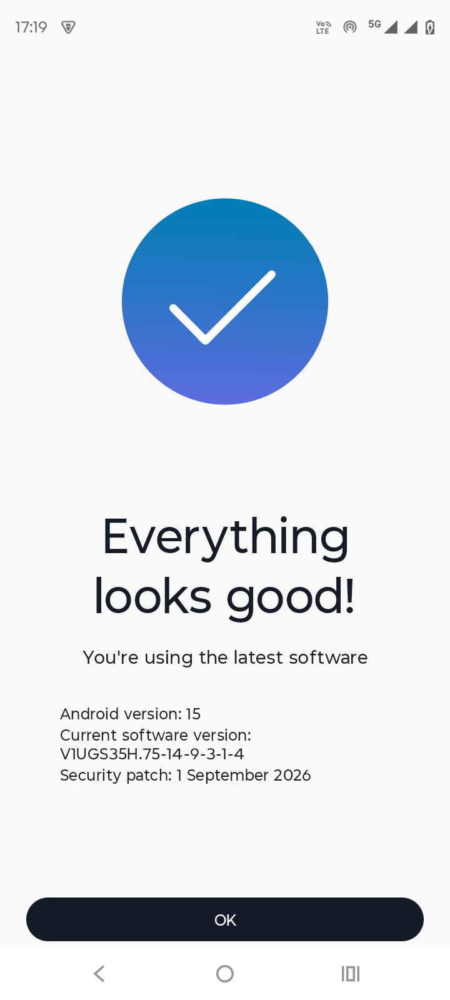

# Moto G45 5G bootloop full diagnosis, fix and recovery guide

**Device:** Motorola Moto G45 5G · `XT2363-9` · codename **`fogos`** · Snapdragon 6s Gen 3 (`SM6375`)
**Symptom:** phone reboots every **~2 minutes**, forever, and it survived three different firmware flashes
**Root cause:** a **use-after-free in Motorola's proprietary oemhook library**, triggered by **stale modem/telephony state in `/data`**
**What actually fixed it:** a **factory reset** — not the OTA, not the latest full firmware, not the latest security-patch build, not the package disables
**Status:** stable after two consecutive factory resets, zero crashes, 5G + VoLTE working (verified over multiple reboots)

This repository is the sanitised, reproducible write-up of one device's recovery: what broke, why, what we tried, what worked, what did **not**, and how to protect your data before you wipe.

> **Not affiliated with Motorola, Qualcomm or Google.** Everything here is from a single device plus general Android/Qualcomm knowledge. Read [DISCLAIMER](#disclaimer) before running anything.

---

## Before you start — what you need

This is not a phone-only fix. You need a **PC** and a **cable**, and most failures happen before the first command.

| You must have | Why |
|---|---|
| **Windows 10/11 PC or laptop** (admin rights) | Motorola's LMSA/Software Fix is Windows-only; all scripts here are PowerShell |
| **USB *data* cable** — not charge-only | Charge-only cables cannot carry ADB. This is the #1 cause of "`adb devices` shows nothing" |
| **ADB installed** (Android SDK Platform-Tools) | Every diagnostic and fix uses it |
| **USB debugging + "Always allow" + screen lock removed** | The boot window is only 1.5–3 minutes; unlocking the phone eats it. Set lock to **None** temporarily |
| **A direct USB port** (no hub/dock) | Hubs drop connections mid-flash |
| **Internet on the PC** + **30–60 GB free disk** | Platform-Tools, gnirehtet, 2–5 GB firmware, backups |
| **Phone charged > 50 %** | First boot after a reset can take 15 minutes |
| **Google account password** | Factory Reset Protection still applies even with no screen lock |
| **Screen lock PIN known** | You need it to remove the lock, and to restore it afterwards |
| **2FA seeds exported, backups done** | A wipe deletes them permanently |

**Full checklist, drivers, cable troubleshooting and the "do I have everything?" list:** [`docs/00-requirements.md`](docs/00-requirements.md)

> You do **not** need root, an unlocked bootloader, a custom ROM, or a paid tool.

---

## TL;DR — if your phone is bootlooping right now

| # | Do this | Why |
|---|---|---|
| 1 | **Back up first** → [`docs/06-backup.md`](docs/06-backup.md) | Factory reset destroys `/data`, including the WhatsApp decryption key and any 2FA authenticator seeds |
| 2 | Confirm it's *this* bug → [`docs/01-symptoms.md`](docs/01-symptoms.md) | A 2-minute reboot loop with `qcrilNrd` in the crash buffer is the fingerprint |
| 3 | Get internet without Wi-Fi/SIM → [`docs/07-internet-without-wifi-or-sim.md`](docs/07-internet-without-wifi-or-sim.md) | `gnirehtet` reverse-tethers the phone through USB — no root, no Wi-Fi, no SIM |
| 4 | **Factory reset** (Recovery → Wipe data/factory reset) | This is what ended the loop. ~5 minutes |
| 5 | Still looping? → LMSA full flash **with "factory reset" checked** | Replaces vendor/modem images *and* wipes userdata |
| 6 | Verify with [`scripts/adb/verify-stability`](scripts/adb/) | Stable = 0 `qcrilNrd` crashes after 10+ min uptime |

If you have 30 seconds, read the [one-screen explanation](docs/03-root-cause.md#the-short-version).

---

## Final state (verified)



After the reset: **Android 15**, build `V1UGS35H.75-14-9-3-1-4`, security patch **1 September 2026**, 5G + VoLTE registered, zero `qcrilNrd` crashes.

The phone went through **three separate firmware flashes** before the reset — the Android 15 update, the latest full firmware via Motorola/Lenovo Software Fix, and the newest security-patch build — and looped on all of them. Only wiping userdata fixed it.

---

## What is actually going on

The phone has two computers: the **AP** (Android, your apps) and the **modem/baseband** (radio, SIM, calls, data). They talk over a channel called **oemhook**, brokered by Qualcomm's RIL daemon `qcrilNrd`.

On this device, Motorola ships a vendor library, `libmotext_inf.so`, that handles oemhook traffic. It contains a bug:

```
Process:  /vendor/bin/hw/qcrilNrd  (uid 1001)
Signal:   SIGSEGV, SEGV_MAPERR, fault addr 0xffffffffffffff02
#00  libqcrilNr.so    qcril_qmi_oem_free_and_convert_ril_token_to_oem_token
#01  libqcrilNr.so    qcril_qmi_oemhook_agent_send
#02  libqcrilNr.so    mot_qcril_qmi_oemhook_agent_send
#03  libmotext_inf.so communicationThread      <-- Motorola proprietary
#04  libc.so          __pthread_start
```

A freed RIL token (`0xffffffffffffff02` = `-254`, a classic "poisoned" pointer) gets dereferenced. `qcrilNrd` dies. `system_server` blocks on a Binder call that will never return. After ~60 s the **watchdog** kills the system and the phone reboots. Repeat every 2 minutes.

The bug is *dormant* in a healthy phone. It only fires when the modem emits unsolicited oemhook indications (`RegRAT`, `UpdateOperator`, `DataState`, `APMState`, `VoiceCallCount`) in a state the library does not expect. In this case that state came from **stale telephony data carried over from before the crash loop started**.

That is why:

- **The Android 15 OTA did not help** — the vendor partition and modem firmware were unchanged.
- **The LMSA "no factory delete" flash did not help** — it deliberately preserves `/data`, and the trigger lives in `/data`.
- **Disabling 13 packages only reduced the crash rate** — apps are a *sender* of oemhook traffic, not the *cause*.
- **A factory reset fixed it** — it wipes `/data/vendor/radio`, carrier/APN state and first-boot reprovisions the modem stack.

Full analysis, including why the popular "factory reset clears modem NVRAM" explanation is imprecise: **[`docs/03-root-cause.md`](docs/03-root-cause.md)**.

---

## Repository map

```
README.md                     you are here
docs/
  00-requirements.md          PC, cable, ADB, drivers, accounts, pre-flight checklist
  01-symptoms.md              recognise this bootloop vs. other causes
  02-diagnosis.md             collect evidence with ADB; read tombstones
  03-root-cause.md            the bug, the trigger, why each fix behaved as it did
  04-fixes.md                 ranked fixes + exact steps + what each one destroys
  05-tutorial.md              plain-language walkthrough, start to finish
  06-backup.md                what to back up, what is unrecoverable, how
  07-internet-without-wifi-or-sim.md   USB reverse tethering with gnirehtet
  08-hardening.md             OPTIONAL debloat + stability monitoring
  09-faq.md                   "can it come back?", warranty, root, LineageOS...
  10-evidence-index.md        what is in evidence/ and how it was sanitised
scripts/
  adb/                        portable .ps1 + .sh: collect, disable, re-enable, verify
  windows/                    tether keeper + watchdog (path-parameterised)
evidence/                     sanitised crash signature, snapshot, logs
PRIVACY.md                    exactly what was removed before publishing
LICENSE                       MIT (code) / CC BY 4.0 (prose)
```

---

## The short version of the fix

```text
Recovery (Power + Volume Down → "Recovery mode")
  → Wipe data/factory reset
  → Reboot system now
```

Everything else in this repo exists because that sentence is useless if you have not backed up, cannot tell whether your loop is the same bug, or the reset does not work.

---

## Disclaimer

Flashing, wiping and `pm disable-user` can brick a device or void warranty. This guide is provided **as-is, with no warranty**. You are responsible for your own device and data.

- A factory reset is **irreversible** for on-device data. Back up first.
- Disabling packages in [`scripts/adb/debloat-optional.txt`](scripts/adb/debloat-optional.txt) can break VoLTE, emergency calling or OTA. It is **optional and reversible**.
- If the phone is under warranty and the reset does not help, use the service centre — do not open the device.

---

## Contributing

Corrections, additional `fogos` builds, or reports of the same crash signature are welcome. Please open an issue with your **build fingerprint**, **baseband version** and a **`logcat -b crash` excerpt** — and scrub your serial/IMEI first. See [`PRIVACY.md`](PRIVACY.md) for the redaction checklist used here.
